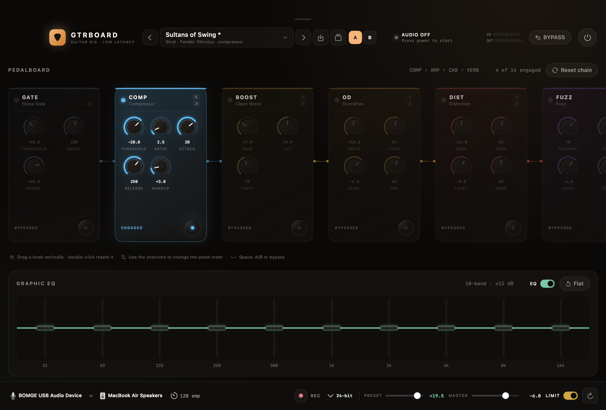

<div align="center">


# GtrBoard

**A guitar board for macOS — no plugin, no DAW, no waiting around.**

Low-latency standalone chain: guitar → 15 pedals → amp → cabinet → IR cabinet →
10-band EQ → recording. 30 factory rigs, user presets in open JSON, A/B banks, click-free
preset crossfades and a menu-bar controller.

<p><b>English</b> · <a href="README.md">🇷🇺 Русский</a></p>

[](#build)
[](#build)
[](#tests)
[](https://github.com/WEBSTUDIUS/GtrBoard/actions/workflows/ci.yml)
[](LICENSE)
[](CHANGELOG.md)

[Quick start](#quickstart) · [AI presets](#ai-presets) · [Recording](#record) ·
[Build](#build) · [Architecture](#architecture)

</div>



> **Want your own tone?** Describe it to any LLM and get a ready `.gtrpreset`
> file — GtrBoard imports it like any other preset. See
> [**AI presets**](#ai-presets).

---

## <a id="contents"></a>Contents

- [What it is](#what)
- [Quick start](#quickstart)
- [Signal chain](#signal)
- [Pedals](#pedals)
- [Amp, cabinet and EQ](#amp-eq)
- [Feedback guard](#feedback-guard)
- [Presets](#presets)
- [🤖 AI presets](#ai-presets)
- [Recording and DAW](#record)
- [Build](#build)
- [Architecture](#architecture)
- [Tests](#tests)
- [Troubleshooting](#trouble)
- [Limitations and roadmap](#limits)
- [License](#license)

## <a id="what"></a>What it is

GtrBoard is a standalone macOS guitar app. It opens your audio interface
directly, processes the signal in real time and sends it to the selected
speakers or headphones. It is **not an AU/VST plugin**: you do not need a DAW
to play.

- **Low latency.** Private aggregate device, HAL AudioUnit, 64–512 sample
  buffer. The current latency is shown in the UI.
- **15 pedals in a real signal chain.** Reorder with the arrows; each pedal has
  a footswitch and LED.
- **Amp and cabinet.** Clean / Crunch / Lead / High Gain voicings, gain, tone
  stack, presence, master, sag; cabinet with low/high cut and resonance.
- **IR cabinet.** Twelve built-in impulses (V30 4x12 SM57 and 57+121, Mesa OS,
  Marshall G12T-75 and V30, Diezel, ENGL, Orange PPC, 5150, Fredman 57/57,
  Djent tight, modern scoop) plus your own WAV: low/high cut, mix, level and
  click-free model switching. IR presets: Enter Sandman IR,
  Enter Sandman IR · EQ, Modern Metal, Djent, Swedish Chainsaw, Doom Wall.
- **Feedback guard.** An automatic suppressor before the chain watches the
  guitar feedback band **above 2 kHz** and 50/60 Hz mains hum, drops narrow
  notches, and if the loop still holds it mutes the input and shows **MUTED**
  (click the badge to re-arm). The **GUARD** switch lives in the footer next to
  LIMIT and in the menu bar. Decaying notes and sustained chords are left
  alone.
- **Drives with 4× oversampling.** Overdrive, distortion and fuzz with distinct
  clipping character.
- **Modulation and time.** Chorus, Flanger, Phaser, Tremolo, Delay (digital /
  analog / ping-pong), Reverb (room / hall / plate).
- **10-band graphic EQ** at 31.5 Hz – 16 kHz, ±12 dB, at the end of the chain.
- **Presets.** 30 factory rigs, user presets, search, JSON import/export, A/B
  banks and space-bar switching.
- **Crossfade.** Two independent chains: the new preset is mixed in over 50 ms
  with no click, silence gap or level jump.
- **Recording.** WAV 24-bit PCM (default) or 32-bit float to `~/Music/GtrBoard`.
- **Menu bar.** Close the window and the audio keeps running.
- **No input mode.** **No Input** runs output-only, without opening the
  microphone or asking for microphone permission.

## <a id="quickstart"></a>Quick start

### 1. Build the app

> **Prebuilt:** [GtrBoard 0.4.0 for macOS, zip](https://github.com/WEBSTUDIUS/GtrBoard/releases/latest).
> Unzip the `.app` and open it. The build is ad-hoc signed; if Gatekeeper
> complains, right-click → **Open**.

```bash
git clone git@github.com:WEBSTUDIUS/GtrBoard.git
cd GtrBoard
./build.sh
open dist/GtrBoard.app
```

The app is in `dist/GtrBoard.app`. It is ad-hoc signed; if Gatekeeper blocks a
copy in `/Applications`, open it with right-click → **Open**.

Other commands:

```bash
./run.sh       # build and open
./install.sh   # install to /Applications (~/Applications fallback)
./test.sh      # DSP/preset self-tests (906 checks)
```

### 2. Plug in a guitar

1. Connect your audio interface and headphones/monitors.
2. In the footer, choose the **input** (guitar interface) and **output**.
3. Buffer: **64–128** samples for playing, **256–512** if the Mac is busy.
4. Press the power button in the top-right corner. macOS asks for microphone
   access — allow it. Audio is processed locally and never uploaded.
5. Play. Input level is set on the interface; output level is the **MASTER**
   knob in the footer.

> **No guitar?** Choose **No Input** in the input menu — the engine starts
> output-only, without the microphone or permission. Useful for checking the
> output path and recording when nothing is plugged in.

> Do not use the built-in microphone and speakers together for playing — that
> causes acoustic feedback. Use headphones while testing.

## <a id="signal"></a>Signal chain

```
Guitar → Interface ─┐
                    ├─ private aggregate device (drift compensation)
Speakers/Phones ←───┘
                                 │
                    HAL AudioUnit (Float32, non-interleaved)
                                 │
                    BoardProcessor (audio thread)
                      Feedback / hum guard → Gate → Compressor → Boost
                      → Overdrive → Distortion → Fuzz → Amplifier
                      → Cabinet → IR Cabinet → Chorus → Flanger
                      → Phaser → Tremolo → Delay → Reverb
                      → 10-band Graphic EQ → Master → Look-ahead Limiter
                                 │
                    selected output
```

## <a id="pedals"></a>Pedals

| Pedal | Parameters | Character |
|---|---|---|
| Noise Gate | threshold, decay, range | hysteresis gate with hold |
| Compressor | threshold, ratio, attack, release, makeup | feed-forward, soft knee, stereo-linked |
| Clean Boost | gain, tilt, tight | transparent boost with low-end cut |
| Overdrive | drive, tone, level, mid | Tube Screamer: HP before clipper, mid hump |
| Distortion | gain, tone, level, edge | mixed soft/hard clipping, angrier than OD |
| Fuzz | sustain, tone, level, bias | Big Muff: two stages, LP/HP blending |
| Amplifier | gain, bass, mid, treble, presence, master, voicing | four-voice preamp + sag |
| Cabinet | low cut, high cut, resonance | 4×12, 110 Hz resonance, 2.6 kHz presence |
| IR Cabinet | model, mix, low cut, high cut, level | 12 built-in impulses plus a custom WAV, one block of latency |
| Chorus | rate, depth, mix, width | two modulated voices, stereo LFO |
| Flanger | rate, depth, feedback, mix, manual | short delay with resonant feedback |
| Phaser | rate, depth, feedback, mix, stages | 4–12 all-pass stages |
| Tremolo | rate, depth, shape, stereo | sine / triangle / square |
| Delay | time, feedback, mix, tone, mode | Digital / Analog / Ping-Pong |
| Reverb | size, damping, mix, pre-delay, mode | Room / Hall / Plate |

Knobs: drag up/down, double-click to reset. The `‹ ›` arrows on a card change
its order; **Reset chain** restores the factory order.

## <a id="amp-eq"></a>Amp, cabinet and EQ

- **Amplifier** — Clean, Crunch, Lead and High Gain voicings. Asymmetric triode
  clipping, envelope-driven sag, passive tone stack.
- **Cabinet** — 24 dB/oct low/high cut, 110 Hz resonance, 2.6 kHz presence.
- **IR Cabinet** — a speaker impulse instead of the analogue cab. Twelve
  synthesised cabinets voiced for metal; the pedal menu opens **Import WAV…**
  for third-party IRs (PCM 8/16/24/32 and float, mono or stereo). Imports are
  copied to `~/Library/Application Support/GtrBoard/IRs`, resampled to the
  session rate, energy-normalised and trimmed to 170 ms. The IR pedal adds 64
  samples of latency, reported in the latency readout. Import restarts audio for
  half a second; switching built-in cabs is click-free (8 ms wet fade). Engaging
  the IR pedal bypasses the analogue Cabinet automatically so the two do not
  stack; both can still be enabled by hand.
- **Graphic EQ** — 10 bands: 31.5, 63, 125, 250, 500, 1k, 2k, 4k, 8k, 16k Hz;
  ±12 dB, Q ≈ 1.41. Sits after the pedals, before master and limiter. **Flat**
  resets all bands; the **EQ** switch bypasses the section.
- **Limiter** — transparent look-ahead ~1.5 ms, always in the path, so changing
  its state does not change latency or click.

### Enter Sandman: two versions

Both use the Mesa OS · SM57 IR with the same gate, boost, Recto-style high gain,
90/7 kHz low/high cut and short room:

| Preset | EQ | What it is for |
|---|---|---|
| **Enter Sandman IR** | graphic EQ flat | an honest IR rig with no extra colour |
| **Enter Sandman IR · EQ** | Black Album curve | closer to the album rhythm tone; A/B it with the first one |

The second version's curve: `31.5` 0, `63` +1, `125` +0.5, `250` −2.5,
`500` −3, `1k` −1.5, `2k` +1.5, `4k` +2, `8k` −2.5, `16k` −5 dB. Low mids are
scooped, presence is added and the fizz is shaved off. Both presets are
level-calibrated, so switching does not jump in volume.

This is an approximation, not a clone: the amp and cab are original models, the
IR is synthesised, and the album tone is double-tracked and mixed. For a closer
match, import your own Mesa IR through **Import WAV…**.

## <a id="feedback-guard"></a>Feedback guard

The guard sits **before** the pedals and works in two layers:

- **Notches.** It drops narrow notches (Q 20) on growing peaks in the
  **2–12 kHz** band, where a guitar rig actually howls. It also catches 50/60 Hz
  mains hum and its harmonics with Q 40 notches for the dangling-jack case.
- **MUTED.** If the dominant peak stays above 2 kHz, the spectrum is stationary
  for about a second and the output is loud, the loop is not something notches
  can break. The guard then mutes the input by −60 dB and shows **MUTED**.
  Click the badge or change the preset to re-arm; the guard itself stays on.

The **GUARD** switch is in the footer next to LIMIT and in the menu bar
(`Enable/Disable Feedback Guard`). Decaying notes, sustained chords and a low B
next to 50/60 Hz are left alone — each has its own test.

> A built-in microphone into built-in speakers with high gain will still
> feedback — physics wins. The guard stops it from howling forever, but playing
> needs headphones or an audio interface.

## <a id="presets"></a>Presets

A preset is a complete snapshot of the board: order and parameters of all 15
pedals, EQ, master volume, output trim, limiter, feedback guard and bypass.

### Factory rigs

<details>
<summary><b>30 factory presets — expand</b></summary>

| Preset | Reference | Tags |
|---|---|---|
| Studio Clean | clean valve amp, compressor, room | clean, studio |
| Sultans of Swing | Strat → Vibrolux, compressor | clean, blues |
| Little Wing | clean Fender + slow phaser | clean, hendrix |
| Texas Flood | TS-808 → clean Fender | blues, lead |
| Slow Dancing | low-gain OD + analog delay | blues, mayer |
| Plexi Crunch | Marshall Plexi, 4×12 | crunch, classic-rock |
| Back in Black | JCM800, minimal effects | crunch, acdc |
| Purple Haze | Fuzz Face → Plexi | fuzz, hendrix |
| Comfortably Numb | Big Muff → Electric Mistress → Hiwatt + delay | lead, floyd |
| Smells Like Teen Spirit | DS-1 → clean Fender + chorus | alternative, grunge |
| Master of Puppets | TS boost → Mark-style high gain, gate | metal, thrash |
| Enter Sandman | Recto-style high gain, gate, room | metal |
| Enter Sandman IR | the same Recto rig through the Mesa OS 4×12 IR | metal, metallica, ir |
| Enter Sandman IR · EQ | the same IR rig plus the Black Album EQ curve | metal, metallica, ir, eq |
| Killing in the Name | cranked JCM800, drop D | metal, rap-rock |
| Seven Nation Army | Big Muff + dark clean | fuzz, riff |
| Streets Have No Name | dotted-8 delay + chorus + clean | ambient, u2 |
| Everlong | distortion + chorus + analog delay | alternative, rock |
| Only Shallow | tremolo + long reverb, shoegaze wall | shoegaze, mbv |
| Ambient Swell | slow tremolo, long delay and hall | ambient, texture |
| Djent Tight | gate + boost + high gain + low-cut | metal, djent |
| Funk Clean | fast compressor, bright clean | funk, clean |
| Garage Rock | OD into a driven amp, room | rock, garage |
| Ain't Talkin' 'Bout Love | Phase 90 → Plexi | crunch, van-halen |
| Whole Lotta Love | Tone Bender → Vox-style edge | fuzz, zeppelin |
| Modern Lead | high gain + digital delay + hall | lead, metal |
| Modern Metal IR | boost → high gain → V30 4×12 IR (SM57) | metal, rhythm, ir |
| Djent IR | tight boost → 5150-style head → Djent IR | metal, djent, ir |
| Swedish Chainsaw IR | hard clip → high gain → Fredman 57/57 IR | metal, death, ir |
| Doom Wall IR | Big Muff → dark amp → Orange PPC IR | metal, doom, ir |

</details>

Factory rigs are **loudness-calibrated**: RMS spread is about 1 dB, so
“Studio Clean → Enter Sandman” does not jump. Calibration lives in
`outputTrim` — the **PRESET** slider in the footer. Double-click its value for
0 dB.

### Presets in this repository

The [`Presets/`](Presets/) folder contains ready-to-import user presets — use
**⌘O** or **Browse Presets → Import**. The first one:
[`Enter Sandman GPT.json`](Presets/Enter%20Sandman%20GPT.json) — a Metallica
*Black Album*-style rhythm: gate, tight overdrive boost, high-gain amp, closed
4×12, scooped EQ and a small room. There are also two Linkin Park presets:
[`Hybrid Theory`](Presets/Linkin%20Park%20-%20Hybrid%20Theory.json) (drop D,
tight high gain, more upper mids, dry) and
[`Faint / Given Up`](Presets/Linkin%20Park%20-%20Faint.json) (more aggressive,
faster gate, brighter presence).

### Save and share

- **Save Preset** (⌘S) — name, gear, tags, notes; writes a `.gtrpreset` file to
  `~/Library/Application Support/GtrBoard/Presets/`.
- **Browse Presets** (⇧⌘P) — search, chain preview, load, export, duplicate,
  delete.
- **Import** (⌘O) / **Export** (⌘E) — exchange JSON files.
- An imported preset gets a new `id` and never overwrites an existing file.

### A/B and the space bar

**A** and **B** in the header are two full board snapshots.

- clicking an empty slot stores the current board;
- clicking a filled slot loads it;
- right-click to reassign, load or clear;
- **space** switches A↔B when both are assigned; otherwise it toggles bypass;
- switching uses a **50 ms crossfade** between two chains — no clicks, no gaps.

### `.gtrpreset` format

Open JSON with a versioned envelope. Minimal example:

```json
{
  "format": "com.andreyilin.gtrboard.preset",
  "version": 1,
  "preset": {
    "name": "My Tone",
    "author": "you",
    "gear": "Tele → clean Fender",
    "tags": ["clean"],
    "notes": "…",
    "settings": {
      "units": [
        { "kind": "amp", "enabled": true, "params": { "gain": 8, "master": -8, "voicing": 0 } },
        { "kind": "cabinet", "enabled": true },
        { "kind": "reverb", "enabled": true, "params": { "mix": 0.15, "mode": 0 } }
      ],
      "graphicEQ": { "enabled": true, "gains": [0, 0, 0, 0, 0, 0, 0, 0, 0, 0] },
      "masterVolume": -6,
      "outputTrim": 0,
      "limiter": true,
      "feedbackGuard": true,
      "bypass": false
    }
  }
}
```

Values are in real units (dB, Hz, ms, 0…1). Missing keys fall back to factory
defaults, unknown keys are dropped and everything is clamped to safe ranges, so
old or third-party presets cannot break the DSP.

## <a id="ai-presets"></a>🤖 AI presets

> **Short version:** GtrBoard does not call an LLM itself. You ask any chat
> model (ChatGPT, Claude, DeepSeek, Gemini) for a board in JSON, save the answer
> as `.gtrpreset` and import it. No API keys, accounts or telemetry from the
> app.

This works because a preset is plain readable JSON, not a proprietary binary.
The model writes the **board structure**; GtrBoard validates and applies it.

### 1. Copy the prompt

```text
You are a guitar tone engineer. Generate ONE GtrBoard preset for this
description: "warm British crunch for humbuckers, a little midrange, light
room reverb".

Return ONLY valid JSON, without markdown fences, comments or explanations:

{
  "format": "com.andreyilin.gtrboard.preset",
  "version": 1,
  "preset": {
    "name": "...",
    "author": "AI + <your name>",
    "gear": "...",
    "tags": ["..."],
    "notes": "...",
    "settings": {
      "units": [
        {"kind": "gate", "enabled": false},
        {"kind": "compressor", "enabled": false},
        {"kind": "boost", "enabled": false},
        {"kind": "overdrive", "enabled": false},
        {"kind": "distortion", "enabled": false},
        {"kind": "fuzz", "enabled": false},
        {"kind": "amp", "enabled": true},
        {"kind": "cabinet", "enabled": true},
        {"kind": "ir", "enabled": false},
        {"kind": "chorus", "enabled": false},
        {"kind": "flanger", "enabled": false},
        {"kind": "phaser", "enabled": false},
        {"kind": "tremolo", "enabled": false},
        {"kind": "delay", "enabled": false},
        {"kind": "reverb", "enabled": true}
      ],
      "graphicEQ": {"enabled": true, "gains": [0,0,0,0,0,0,0,0,0,0]},
      "masterVolume": -6,
      "outputTrim": 0,
      "limiter": true,
      "bypass": false
    }
  }
}

Rules:
1. `units` must contain exactly 15 kinds in this order: gate, compressor,
   boost, overdrive, distortion, fuzz, amp, cabinet, ir, chorus, flanger,
   phaser, tremolo, delay, reverb. Enable the ones you need.
2. Parameters are optional — omit them to use factory defaults. When present,
   use real units: dB, Hz, ms; percentages are 0…1.
3. Switches: amp.voicing 0 Clean / 1 Crunch / 2 Lead / 3 High Gain;
   phaser.stages 0=4 / 1=6 / 2=8 / 3=12; tremolo.shape 0 Sine / 1 Triangle /
   2 Square; delay.mode 0 Digital / 1 Analog / 2 Ping-Pong; reverb.mode
   0 Room / 1 Hall / 2 Plate.
4. `graphicEQ.gains` has exactly 10 dB values in this order: 31.5…16k Hz.
5. masterVolume is −60…12 dB; outputTrim is −24…24 dB.
6. Do not add id, createdAt, modifiedAt or isBuiltIn. JSON only.
```

### 2. Save the answer

Copy the JSON into a file such as `MyTone.gtrpreset` (UTF-8). If the model
wrapped it in ` ```json `, remove the fences and keep only `{ … }`.

### 3. Import it

In GtrBoard: **⌘O** (Import) or **Browse Presets → Import**. The preset appears
in the library. You can then assign it to **A/B**, tweak knobs and save your own
version.

### Good to know

- **Leave `outputTrim: 0`** when generating. After import, adjust level with
  the **PRESET** slider so presets do not jump in volume.
- **List all 15 `kind` values explicitly.** Omitted units are added with factory
  defaults (amp, cabinet and reverb are enabled by default), which can add
  unexpected reverb.
- **The model cannot hear your rig.** The same JSON sounds different on another
  guitar or interface; trust your ears.
- **Ask for several variations** (“less gain”, “more mids”, “add delay”) and
  compare them in A/B.
- **Never paste secrets.** Generation happens in an external service.

📚 **Full parameter reference, ranges, switch indices and a ready example**:
[`docs/AI_PRESETS.en.md`](docs/AI_PRESETS.en.md). Example file:
[`docs/examples/ai-british-crunch.gtrpreset`](docs/examples/ai-british-crunch.gtrpreset).

## <a id="record"></a>Recording and DAW

### WAV

**REC** in the footer (or ⇧⌘R) records the processed output to:

```
~/Music/GtrBoard/GtrBoard-YYYY-MM-DD-HHMMSS.wav
```

- 2 channels at the device sample rate (usually 48 kHz);
- **24-bit PCM** by default or **32-bit float** — switch next to REC;
- recorded after amp, cabinet, EQ, master and limiter — exactly what you hear;
- the audio thread writes into a lock-free ring and a background queue flushes
  it to disk: no locks or allocations in the render callback, no dropouts or
  clicks;
- press REC again to stop; the file is ready immediately;
- right-click REC → **Reveal Last Recording in Finder**.

### Live input into a DAW via BlackHole

1. Install the free **BlackHole 2ch**.
2. In GtrBoard, choose **BlackHole 2ch** as the output.
3. In Logic/Reaper/Ableton, create a track with **BlackHole 2ch** as input.
4. Monitor through your interface/headphones, not through BlackHole, or you
   will create a feedback loop.

Latency is the sum of the GtrBoard and DAW buffers. That is fine for
recording; for live monitoring, play through the interface output.

> A real AUv3 plugin, so the DAW hosts GtrBoard directly, is on the roadmap.
> For now BlackHole/WAV is the honest way to get the sound into a DAW.

## <a id="build"></a>Build

### Requirements

- macOS **14.0+** (tested on macOS 27.2, Apple Silicon);
- Swift 6 / Command Line Tools; full Xcode is not required;
- an audio interface (or the built-in microphone for experiments).

```bash
git clone git@github.com:WEBSTUDIUS/GtrBoard.git
cd GtrBoard
./build.sh
open dist/GtrBoard.app
```

- `./build.sh` builds release and the `.app` bundle in `dist/`.
- `./run.sh` builds and opens it.
- `./install.sh` installs to `/Applications` (fallback `~/Applications`).
- `./test.sh` runs self-tests.

> **Command Line Tools and SwiftUI macros.** In the macOS 27 SDK the SwiftUI
> macros are declared but the `SwiftUIMacros` plugin is not shipped with CLT.
> `build.sh` automatically uses the 26.5 SDK when it exists; override with
> `GTRBOARD_SDK=/path/to/MacOSX.sdk ./build.sh`.

## <a id="architecture"></a>Architecture

```
Sources/
  BoardCore/              # no Core Audio/AppKit: DSP, models, presets
    DSP/                  # effect nodes, oversampler, reverb, limiter
    BoardSettings.swift   # complete board snapshot
    BuiltInPresets.swift  # 30 factory rigs
  GtrBoard/
    Audio/                # HAL, aggregate device, render callback, recorder
    UI/                   # SwiftUI: pedalboard, EQ, presets, footer
    AppModel.swift        # state, persistence, import/export
Tests/GtrBoardSelfTest/   # headless DSP and preset checks
```

**Real-time rules:** the UI publishes a settings snapshot into lock-protected
buffers; the audio thread copies it with `trylock`, with no blocking locks or
allocations inside `process`. All delay lines and filter states are allocated in
`prepare(sampleRate:)`. Parameters are smoothed and biquad coefficients are
interpolated per sample.

**Preset crossfade:** the processor owns two complete chains (their own filters,
EQ, master and limiter). On a preset change the second chain is prepared and
crossfaded in over 50 ms while the current chain keeps playing and fades out.

## <a id="tests"></a>Tests

```bash
./test.sh
```

Covered:

- effect catalogue and parameter normalisation;
- serialisation of all 30 factory presets and tolerant decoding;
- preset store write/read/export/import;
- biquad and graphic-EQ frequency response;
- rendering every factory rig: finite, no clipping, signal present;
- gate, compressor, drives, amp, delay, reverb, modulation;
- IR: cabinet library, convolution vs direct convolution, 16/24/32-bit and
  float WAV import, click-free model switching;
- feedback guard: howl, mains hum, a low B next to 50/60 Hz, silence, a closed
  acoustic loop and the latched mute;
- bypass, master, limiter;
- crossfade: no click, no silence gap, no level jump;
- validity of the AI example in `docs/examples/`;
- throughput: a full high-gain board renders ~75× faster than real time on
  Apple Silicon.

Current run: **906 checks**, all passing. GitHub Actions runs the same suite on
every push and pull request and uploads the built `.app` as an artifact.

## <a id="trouble"></a>Troubleshooting

| Symptom | What to do |
|---|---|
| No sound | Choose input and output, press power; check **No Input** and master |
| Clicks / crackle | Raise the buffer to 256–512; close heavy apps |
| Microphone denied | System Settings → Privacy & Security → Microphone → GtrBoard |
| Feedback / howl | Do not use built-in mic and speakers together; use headphones |
| Preset will not import | Check JSON quotes, commas and remove ``` fences |
| Preset too quiet/loud | **PRESET** slider in the footer; `outputTrim` in JSON |
| Device disappeared | **Refresh Devices** in the menu or restart audio with power |
| Sample rate changed in Audio MIDI Setup | Restart audio with the power button |

## <a id="limits"></a>Limitations and roadmap

- no AU/VST/AUv3 — standalone only;
- no IR/cabinet impulse loader; the cabinet is synthesized with filters;
- no tuner, metronome, MIDI control or scene/snapshot layer;
- input is processed as mono (first channel);
- no third-party preset import;
- ad-hoc signing: distribution needs a Developer ID and notarization.

Next: AUv3 wrapper, IR loader, tuner, MIDI pedal, scene layer, pedal drag-and-drop.

## <a id="license"></a>License

MIT. See [LICENSE](LICENSE).

---

<div align="center">
<sub>Made for guitar, macOS and the silence between presets.</sub>
</div>
