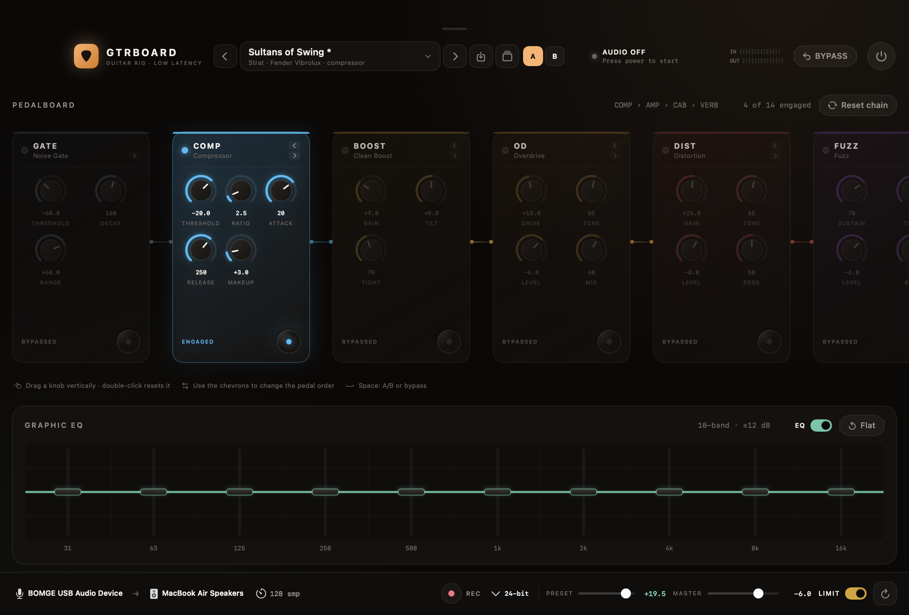

<div align="center">


# GtrBoard

**Гитарный борд для macOS — без плагина, без DAW, без задержки на подумать.**

Низколатентный standalone-тракт: гитара → 14 педалей → усилитель → кабинет →
10-полосный EQ → запись. 24 заводских пресета, свои пресеты в открытом JSON,
A/B-банки, кроссфейд между пресетами и меню-бар.

[](#build)
[](#build)
[](#tests)
[](LICENSE)
[](CHANGELOG.md)
[](https://github.com/WEBSTUDIUS/GtrBoard/actions/workflows/ci.yml)

<p><b>Русский</b> · <a href="README.en.md">🇬🇧 English</a></p>

[Быстрый старт](#quickstart) · [Пресеты с ИИ](#ai-presets) · [Запись](#record) ·
[Сборка](#build) · [Архитектура](#architecture)

</div>



> **Хочешь свой звук?** Опиши его словами в любом чате с ИИ и получи готовый
> `.gtrpreset` — GtrBoard импортирует его как обычный пресет. Подробности:
> [**Пресеты с помощью ИИ**](#ai-presets).

---

## <a id="contents"></a>Содержание

- [Что это](#what)
- [Быстрый старт](#quickstart)
- [Сигнальная цепь](#signal)
- [Педали](#pedals)
- [Усилитель, кабинет и EQ](#amp-eq)
- [Пресеты](#presets)
- [🤖 Пресеты с помощью ИИ](#ai-presets)
- [Запись и DAW](#record)
- [Сборка](#build)
- [Архитектура](#architecture)
- [Тесты](#tests)
- [Если что-то не так](#trouble)
- [Ограничения и планы](#limits)
- [Лицензия](#license)

## <a id="what"></a>Что это

GtrBoard — самостоятельное macOS-приложение для гитары. Оно открывает
аудиоинтерфейс напрямую, обрабатывает сигнал в реальном времени и выводит его
на выбранные колонки или наушники. Это **не AU/VST-плагин**: DAW не нужен,
чтобы просто играть.

- **Низкая задержка.** Приватный aggregate-девайс, HAL AudioUnit, буфер
  64–512 сэмплов. Задержка видна в интерфейсе.
- **14 педалей в настоящей цепи.** Порядок меняется стрелками; каждая педаль
  включается футсвитчем или LED.
- **Усилитель и кабинет.** Clean / Crunch / Lead / High Gain, gain, темброблок,
  presence, master, sag; кабинет с low/high cut и резонансом.
- **Драйвы с 4× oversampling.** Overdrive, distortion и fuzz с разным
  характером клиппинга.
- **Модуляция и время.** Chorus, Flanger, Phaser, Tremolo, Delay (digital /
  analog / ping-pong), Reverb (room / hall / plate).
- **10-полосный графический EQ** 31.5 Гц – 16 кГц, ±12 дБ, в конце цепи.
- **Пресеты.** 24 заводских рига, свои пресеты, поиск, импорт/экспорт JSON,
  A/B-банки и переключение пробелом.
- **Кроссфейд.** Две независимые цепи: новый пресет подмешивается за 50 мс —
  без щелчка, паузы и скачка уровня.
- **Запись.** WAV 24-bit PCM (по умолчанию) или 32-bit float в
  `~/Music/GtrBoard`.
- **Меню-бар.** Окно можно закрыть — обработка и быстрый доступ остаются.
- **Вход можно отключить.** Режим **No Input** работает только на выход, без
  микрофона и без запроса доступа.

## <a id="quickstart"></a>Быстрый старт

### 1. Соберите приложение

```bash
git clone git@github.com:WEBSTUDIUS/GtrBoard.git
cd GtrBoard
./build.sh
open dist/GtrBoard.app
```

Готовое приложение — `dist/GtrBoard.app`. Сборка подписана ad-hoc; если
Gatekeeper блокирует копию в `/Applications`, откройте её через правый клик →
**Open**.

Ещё команды:

```bash
./run.sh       # собрать и открыть
./install.sh   # установить в /Applications (~/Applications как fallback)
./test.sh      # DSP/пресет self-tests (700 проверок)
```

### 2. Подключите гитару

1. Подключите аудиоинтерфейс и наушники/мониторы.
2. В футере выберите **вход** (гитарный интерфейс) и **выход**.
3. Буфер: **64–128** сэмплов для игры, **256–512** если компьютер загружен.
4. Нажмите кнопку питания в правом верхнем углу. macOS попросит доступ к
   микрофону — разрешите. Сигнал обрабатывается локально и никуда не уходит.
5. Играйте. Вход регулируется на интерфейсе, выход — ручкой **MASTER**.

> **Без гитары?** Выберите **No Input** в меню входа — движок запустится
> только на выход, без микрофона и без разрешения. Удобно для проверки
> выхода и записи, когда гитара не подключена.

> Не выбирайте встроенные микрофон и колонки одновременно для игры — будет
> акустическая обратная связь. Для проверки тракта используйте наушники.

## <a id="signal"></a>Сигнальная цепь

```
Guitar → Interface ─┐
                    ├─ private aggregate device (drift compensation)
Speakers/Phones ←───┘
                                 │
                    HAL AudioUnit (Float32, non-interleaved)
                                 │
                    BoardProcessor (audio thread)
                      Gate → Compressor → Boost → Overdrive → Distortion
                      → Fuzz → Amplifier → Cabinet → Chorus → Flanger
                      → Phaser → Tremolo → Delay → Reverb
                      → 10-band Graphic EQ → Master → Look-ahead Limiter
                                 │
                    выбранный выход
```

## <a id="pedals"></a>Педали

| Педаль | Параметры | Характер |
|---|---|---|
| Noise Gate | threshold, decay, range | гистерезисный гейт с удержанием |
| Compressor | threshold, ratio, attack, release, makeup | feed-forward, soft knee, стерео-связанный |
| Clean Boost | gain, tilt, tight | прозрачный буст с обрезом низа |
| Overdrive | drive, tone, level, mid | Tube Screamer: HP перед клиппером, mid-горб |
| Distortion | gain, tone, level, edge | смешанный soft/hard клиппинг, злее овердрайва |
| Fuzz | sustain, tone, level, bias | Big Muff: два каскада, LP/HP-блендинг |
| Amplifier | gain, bass, mid, treble, presence, master, voicing | четырёхголосный преамп + sag |
| Cabinet | low cut, high cut, resonance | 4×12, резонанс 110 Гц, presence 2.6 кГц |
| Chorus | rate, depth, mix, width | два модулированных голоса, стерео-LFO |
| Flanger | rate, depth, feedback, mix, manual | короткая линия с резонансной ОС |
| Phaser | rate, depth, feedback, mix, stages | 4–12 all-pass ступеней |
| Tremolo | rate, depth, shape, stereo | sine / triangle / square |
| Delay | time, feedback, mix, tone, mode | Digital / Analog / Ping-Pong |
| Reverb | size, damping, mix, pre-delay, mode | Room / Hall / Plate |

Ручки: тяните вверх/вниз, двойной клик — сброс. Стрелки `‹ ›` на карточке
меняют порядок, **Reset chain** возвращает заводской.

## <a id="amp-eq"></a>Усилитель, кабинет и EQ

- **Amplifier** — четыре голоса: Clean, Crunch, Lead, High Gain. Асимметричный
  триодный клип, sag по огибающей, пассивный темброблок.
- **Cabinet** — 24 дБ/окт low/high cut, резонанс 110 Гц, presence 2.6 кГц.
- **Graphic EQ** — 10 полос: 31.5, 63, 125, 250, 500, 1k, 2k, 4k, 8k, 16k Гц;
  ±12 дБ, Q ≈ 1.41. Стоит после педалей, перед master и лимитером. **Flat**
  сбрасывает полосы, переключатель **EQ** выключает секцию.
- **Limiter** — прозрачный look-ahead ~1.5 мс, всегда в цепи, поэтому его
  включение/выключение не меняет задержку и не щёлкает.

## <a id="presets"></a>Пресеты

Пресет — полный снимок борда: порядок и параметры всех 14 педалей, EQ,
master volume, output trim, limiter и bypass.

### Заводские риги

<details>
<summary><b>24 заводских пресета — развернуть</b></summary>

| Пресет | Ориентир | Теги |
|---|---|---|
| Studio Clean | чистый ламповый усилитель, компрессор, рум | clean, studio |
| Sultans of Swing | Strat → Vibrolux, компрессор | clean, blues |
| Little Wing | чистый Fender + медленный phaser | clean, hendrix |
| Texas Flood | TS-808 → чистый Fender | blues, lead |
| Slow Dancing | низкий OD + аналоговый дилей | blues, mayer |
| Plexi Crunch | Marshall Plexi, 4×12 | crunch, classic-rock |
| Back in Black | JCM800, минимум эффектов | crunch, acdc |
| Purple Haze | Fuzz Face → Plexi | fuzz, hendrix |
| Comfortably Numb | Big Muff → Electric Mistress → Hiwatt + дилей | lead, floyd |
| Smells Like Teen Spirit | DS-1 → чистый Fender + chorus | alternative, grunge |
| Master of Puppets | TS-буст → Mark-подобный high gain, гейт | metal, thrash |
| Enter Sandman | Recto-подобный high gain, гейт, рум | metal |
| Killing in the Name | JCM800 на громкости, drop D | metal, rap-rock |
| Seven Nation Army | Big Muff + тёмный чистый | fuzz, riff |
| Streets Have No Name | доттед-8-дилей + chorus + чистый | ambient, u2 |
| Everlong | distortion + chorus + аналоговый дилей | alternative, rock |
| Only Shallow | тремоло + длинный реверб, shoegaze | shoegaze, mbv |
| Ambient Swell | медленное тремоло, длинные дилей и холл | ambient, texture |
| Djent Tight | гейт + буст + высокий gain + low-cut | metal, djent |
| Funk Clean | быстрый компрессор, яркий чистый | funk, clean |
| Garage Rock | OD в разогнанный усилитель, рум | rock, garage |
| Ain't Talkin' 'Bout Love | Phase 90 → Plexi | crunch, van-halen |
| Whole Lotta Love | Tone Bender → Vox-подобный край | fuzz, zeppelin |
| Modern Lead | high gain + цифровой дилей + холл | lead, metal |

</details>

Заводские пресеты **откалиброваны по громкости**: разброс RMS около 1 дБ,
поэтому «Studio Clean → Enter Sandman» не выстреливает. Калибровка живёт в
`outputTrim` — ползунок **PRESET** в футере. Двойной клик по значению — 0 дБ.

### Сохранение и обмен

- **Save Preset** (⌘S) — имя, gear, теги, заметки; файл `.gtrpreset` пишется в
  `~/Library/Application Support/GtrBoard/Presets/`.
- **Browse Presets** (⇧⌘P) — поиск, предпросмотр цепи, загрузка, экспорт,
  дублирование, удаление.
- **Import** (⌘O) / **Export** (⌘E) — обмен JSON-файлами.
- Импортированный пресет получает новый `id` и не перезаписывает существующий.

### A/B и пробел

**A** и **B** в шапке — два полных снимка борда.

- пустой слот по клику сохраняет текущий борд;
- заполненный — загружает снимок;
- правый клик — переназначить, загрузить или очистить;
- **пробел** переключает A↔B, если назначены оба; иначе включает/выключает
  bypass;
- переключение идёт через **кроссфейд 50 мс** между двумя цепями — без
  щелчков и провалов.

### Формат `.gtrpreset`

Открытый JSON с конвертом версии. Минимальный пример:

```json
{
  "format": "com.andreyilin.gtrboard.preset",
  "version": 1,
  "preset": {
    "name": "My Tone",
    "author": "you",
    "gear": "Tele → clean Fender",
    "tags": ["clean"],
    "notes": "…",
    "settings": {
      "units": [
        { "kind": "amp", "enabled": true, "params": { "gain": 8, "master": -8, "voicing": 0 } },
        { "kind": "cabinet", "enabled": true },
        { "kind": "reverb", "enabled": true, "params": { "mix": 0.15, "mode": 0 } }
      ],
      "graphicEQ": { "enabled": true, "gains": [0, 0, 0, 0, 0, 0, 0, 0, 0, 0] },
      "masterVolume": -6,
      "outputTrim": 0,
      "limiter": true,
      "bypass": false
    }
  }
}
```

Параметры — в реальных единицах (dB, Hz, ms, 0…1). Недостающие ключи
заполняются заводскими значениями, лишние отбрасываются, всё клампится в
допустимые диапазоны. Поэтому старые и чужие пресеты не могут «сломать» DSP.

## <a id="ai-presets"></a>🤖 Пресеты с помощью ИИ

> **Коротко:** GtrBoard не вызывает нейросети сам. Вы просите любой чат с LLM
> (ChatGPT, Claude, DeepSeek, Gemini) описать борд в JSON, сохраняете ответ
> как `.gtrpreset` и импортируете. Никаких API-ключей, аккаунтов и отправки
> телеметрии из приложения.

Это работает потому, что формат пресета — обычный читаемый JSON, а не
проприетарный бинарник. Модель пишет **структуру борда**, а GtrBoard проверяет
и применяет значения.

### 1. Скопируйте промпт

```text
Ты — гитарный звукорежиссёр. Сгенерируй ОДИН пресет для GtrBoard по описанию:
«тёплый британский кранч для хамбакеров, немного середины, лёгкий рум».

Верни ТОЛЬКО валидный JSON без markdown, комментариев и пояснений:

{
  "format": "com.andreyilin.gtrboard.preset",
  "version": 1,
  "preset": {
    "name": "...",
    "author": "AI + <твоё имя>",
    "gear": "...",
    "tags": ["..."],
    "notes": "...",
    "settings": {
      "units": [
        {"kind": "gate", "enabled": false},
        {"kind": "compressor", "enabled": false},
        {"kind": "boost", "enabled": false},
        {"kind": "overdrive", "enabled": false},
        {"kind": "distortion", "enabled": false},
        {"kind": "fuzz", "enabled": false},
        {"kind": "amp", "enabled": true},
        {"kind": "cabinet", "enabled": true},
        {"kind": "chorus", "enabled": false},
        {"kind": "flanger", "enabled": false},
        {"kind": "phaser", "enabled": false},
        {"kind": "tremolo", "enabled": false},
        {"kind": "delay", "enabled": false},
        {"kind": "reverb", "enabled": true}
      ],
      "graphicEQ": {"enabled": true, "gains": [0,0,0,0,0,0,0,0,0,0]},
      "masterVolume": -6,
      "outputTrim": 0,
      "limiter": true,
      "bypass": false
    }
  }
}

Правила:
1. В units ровно 14 kind в этом порядке: gate, compressor, boost, overdrive,
   distortion, fuzz, amp, cabinet, chorus, flanger, phaser, tremolo, delay,
   reverb. Включай нужные через enabled.
2. Параметры можно опускать — возьмутся заводские. Если указываешь — реальные
   единицы: dB, Hz, ms; проценты 0…1.
3. Переключатели: amp.voicing 0 Clean / 1 Crunch / 2 Lead / 3 High Gain;
   phaser.stages 0=4 / 1=6 / 2=8 / 3=12; tremolo.shape 0 Sine / 1 Triangle /
   2 Square; delay.mode 0 Digital / 1 Analog / 2 Ping-Pong; reverb.mode
   0 Room / 1 Hall / 2 Plate.
4. graphicEQ.gains — 10 чисел в dB, порядок 31.5…16k Гц.
5. masterVolume −60…12 dB; outputTrim −24…24 dB.
6. Не добавляй id, createdAt, modifiedAt, isBuiltIn. Только JSON.
```

### 2. Сохраните ответ

Скопируйте JSON в файл, например `MyTone.gtrpreset` (UTF-8). Если модель
обернула ответ в ` ```json ` — удалите ограждения, оставьте только `{ … }`.

### 3. Импортируйте

В GtrBoard: **⌘O** (Import) или **Browse Presets → Import**. Пресет появится
в библиотеке. Дальше его можно назначить в **A/B**, крутить ручки и сохранить
свою версию.

### Что важно знать

- **Оставляйте `outputTrim: 0`** при генерации. После импорта подстройте
  громкость ползунком **PRESET** — так пресеты не будут прыгать по уровню.
- **Все 14 `kind` лучше перечислять явно.** Если единицу не указать, GtrBoard
  добавит её с заводскими настройками (amp, cabinet и reverb по умолчанию
  включены) — можно получить неожиданный реверб.
- **Модель не слышит ваш тракт.** Один и тот же JSON на разных гитарах и
  интерфейсах звучит по-разному; правьте ушами.
- **Просите несколько вариантов** («меньше гейна», «больше середины», «с
  дилеем») и сравнивайте в A/B.
- **Не вставляйте секреты.** Генерация идёт во внешнем сервисе.

📚 **Полный справочник параметров, диапазоны, индексы переключателей и готовый
пример** — в [`docs/AI_PRESETS.md`](docs/AI_PRESETS.md)
([English version](docs/AI_PRESETS.en.md)). Пример файла:
[`docs/examples/ai-british-crunch.gtrpreset`](docs/examples/ai-british-crunch.gtrpreset).

## <a id="record"></a>Запись и DAW

### WAV

**REC** в футере (или ⇧⌘R) пишет обработанный выход в:

```
~/Music/GtrBoard/GtrBoard-YYYY-MM-DD-HHMMSS.wav
```

- 2 канала, частота устройства (обычно 48 кГц);
- **24-bit PCM** по умолчанию или **32-bit float** — переключатель рядом с REC;
- запись идёт после усилителя, кабинета, EQ, master и лимитера — ровно то,
  что слышно;
- аудиопоток пишет в lock-free кольцо, фоновый поток сливает на диск: без
  локов и аллокаций в render-callback, без провалов и щелчков;
- повторное нажатие REC останавливает запись, файл сразу готов;
- правый клик по REC → **Reveal Last Recording in Finder**.

### Живой вход в DAW через BlackHole

1. Установите бесплатный **BlackHole 2ch**.
2. В GtrBoard выберите выход **BlackHole 2ch**.
3. В Logic/Reaper/Ableton создайте трек с входом **BlackHole 2ch**.
4. Слушайте себя через выход интерфейса/наушники, не через BlackHole, иначе
   получится петля.

Задержка складывается из буферов GtrBoard и DAW. Для записи это нормально;
для живого мониторинга лучше играть через выход интерфейса.

> AUv3-плагин, чтобы DAW сам хостил GtrBoard, — в дорожной карте. Пока
> BlackHole/WAV — честный способ отдать звук в DAW.

## <a id="build"></a>Сборка

### Требования

- macOS **14.0+** (проверено на macOS 27.2, Apple Silicon);
- Swift 6 / Command Line Tools; полный Xcode не обязателен;
- аудиоинтерфейс (или встроенный микрофон для экспериментов).

```bash
git clone git@github.com:WEBSTUDIUS/GtrBoard.git
cd GtrBoard
./build.sh
open dist/GtrBoard.app
```

- `./build.sh` собирает release и `.app` в `dist/`.
- `./run.sh` — собрать и открыть.
- `./install.sh` — установить в `/Applications` (fallback `~/Applications`).
- `./test.sh` — self-tests.

> **Command Line Tools и SwiftUI-макросы.** В SDK macOS 27 макросы SwiftUI
> объявлены, но плагин `SwiftUIMacros` в CLT не поставляется. `build.sh`
> автоматически собирает с SDK 26.5, если он есть; переопределить можно через
> `GTRBOARD_SDK=/path/to/MacOSX.sdk ./build.sh`.

## <a id="architecture"></a>Архитектура

```
Sources/
  BoardCore/              # без Core Audio/AppKit: DSP, модели, пресеты
    DSP/                  # узлы эффектов, oversampler, reverb, limiter
    BoardSettings.swift   # полный снимок борда
    BuiltInPresets.swift  # 24 заводских рига
  GtrBoard/
    Audio/                # HAL, aggregate-девайс, render callback, рекордер
    UI/                   # SwiftUI: педалборд, EQ, пресеты, футер
    AppModel.swift        # состояние, персистентность, импорт/экспорт
Tests/GtrBoardSelfTest/   # headless-проверки DSP и пресетов
```

**Real-time правила:** UI пишет снимок настроек в lock-protected буферы;
аудиопоток забирает его через `trylock`, без блокировок и аллокаций в
`process`. Все линии задержки и состояния фильтров выделяются в
`prepare(sampleRate:)`. Параметры сглаживаются; коэффициенты биквадов
интерполируются по сэмплам.

**Кроссфейд пресетов:** в процессоре две полные цепи (свои фильтры, EQ,
master, limiter). При смене пресета вторая цепь готовится и 50 мс
перекрёстно подмешивается; текущая цепь продолжает звучать и плавно уходит.

## <a id="tests"></a>Тесты

```bash
./test.sh
```

Проверяется:

- каталог эффектов и нормализация параметров;
- сериализация всех 24 заводских пресетов и tolerant-декодирование;
- запись/чтение/экспорт/импорт `.gtrpreset`;
- АЧХ биквадов и графического EQ;
- рендер всех заводских ригов: конечность, отсутствие клиппинга, сигнал;
- gate, compressor, drives, amp, delay, reverb, modulation;
- bypass, master, limiter;
- кроссфейд: нет щелчка, нет провала в тишину, уровень не прыгает;
- валидность AI-примера из `docs/examples/`;
- пропускная способность: полный high-gain борд рендерится в ~75 раз быстрее
  реального времени на Apple Silicon.

Текущий прогон: **700 проверок**, все проходят.

## <a id="trouble"></a>Если что-то не так

| Симптом | Что сделать |
|---|---|
| Нет звука | Выберите вход и выход, нажмите питание; проверьте **No Input** и master |
| Щелчки/треск | Увеличьте буфер до 256–512; закройте тяжёлые приложения |
| Микрофон не разрешён | System Settings → Privacy & Security → Microphone → GtrBoard |
| Эхо/свист | Не используйте встроенные микрофон и колонки одновременно; наденьте наушники |
| Пресет не импортируется | Проверьте JSON: кавычки, запятые, нет ```-ограждений |
| Пресет тихий/громкий | Ползунок **PRESET** в футере; `outputTrim` в JSON |
| Устройство пропало | **Refresh Devices** в меню или перезапустите аудио питанием |
| Смена sample rate в Audio MIDI Setup | Перезапустите аудио кнопкой питания |

## <a id="limits"></a>Ограничения и планы

- нет AU/VST/AUv3 — только standalone;
- нет загрузчика IR/кабинетных импульсов; кабинет синтезирован фильтрами;
- нет тюнера, метронома, MIDI и scene/snapshot-слоя;
- вход обрабатывается как моно (первый канал);
- пресеты других вендоров не импортируются;
- ad-hoc подпись: для распространения нужен Developer ID и notarization.

Ближайшие планы: AUv3-обёртка, IR-загрузчик, тюнер, MIDI-педаль, scene-слой,
drag-and-drop педалей.

## <a id="license"></a>Лицензия

MIT. См. [LICENSE](LICENSE).

---

<div align="center">
<sub>Сделано для гитары, macOS и тишины между пресетами.</sub>
</div>
